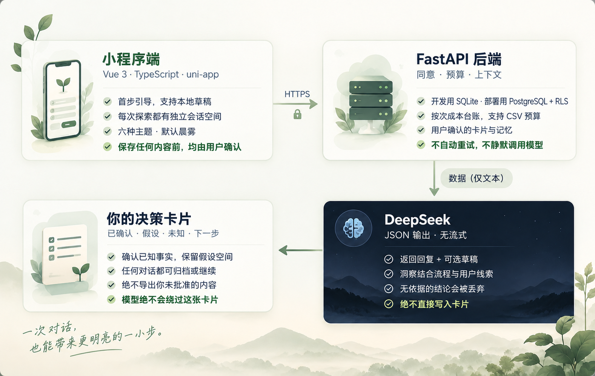

# Agency Bloom

<p align="center">
  
</p>

<p align="center">
  <a href="README.md">English</a>&nbsp;&nbsp;·&nbsp;&nbsp;
  <em>Your Life. Your Direction. Your Agency.</em>
</p>

<p align="center">
  <a href="https://github.com/Annabelle0726/Agency-Bloom/actions/workflows/check.yml"></a>
  
  
  <a href="LICENSE_zh.md"></a>
</p>

<p align="center">
  
  
  
  
</p>

<p align="center">
  
  
  
  
  
</p>

**Agency Bloom** 是一个面向成年人的微信小程序：理清此刻的处境，比较可能的选择，然后选一个代价可承受的小尝试。Alpha 一次只跟进一个当前问题，所有 AI 建议都只是草稿，经你确认才会写入卡片。

## 它不一样在哪

- **决策权在你手里。** 模型只负责建议；确认信息、推测、待核实项在卡片上明确分区，只有你确认的内容才会保存。
- **有依据才出现。** 可选的 Insight 必须逐字引用至少两条你自己的原话作为依据，后端找不到依据就直接丢弃。
- **默认克制，记忆自选。** 完整聊天保存是可选项；长期记忆由你逐条确认、区分范围（全局或单个探索），是否用于回复是独立开关，默认关闭。
- **上下文有边界。** 每段会话只携带自己的最近消息、已审阅总结和明确关联的探索，绝不悄悄合并其他会话的记录。
- **预算有账本。** 每次模型调用先按峰值价格预留额度，成功后按 token 回执结算；不自动重试，失败也不伪装成演示回复。

## 工作原理

<p align="center">
  
</p>

## 快速开始

需要 Node.js 22+、npm、uv 和微信开发者工具。在仓库根目录的 PowerShell 中执行：

```powershell
npm ci
npm --prefix apps/miniprogram ci
uv sync --directory apps/api --frozen
# 仅在文件不存在时创建，不覆盖已有凭证
if (-not (Test-Path apps/api/.env)) { Copy-Item apps/api/.env.example apps/api/.env }
```

保持两个终端：

```powershell
# 终端 1 —— 后端 API，地址 http://127.0.0.1:8000
npm run dev:api

# 终端 2 —— 小程序监听编译 + 打开开发者工具
npm run dev:wechat
```

`dev:mp` 只编译不打开工具；`npm run dev` 提供辅助 H5 预览（`http://127.0.0.1:5173`）。**微信开发者工具是真实 UI 的主要验收环境**——H5 通过不能证明 WXSS、胶囊、键盘和安全区正确。

新拉取仓库的 AI 默认是 `demo` 模式（无付费调用）。要启用真实 DeepSeek 对话，在被 Git 忽略的 `apps/api/.env` 中配置后重启 `dev:api`：

```ini
AGENCY_AI_MODE=deepseek
AGENCY_DEEPSEEK_MODEL=deepseek-flash
AGENCY_DEEPSEEK_BASE_URL=https://api.deepseek.com
AGENCY_DEEPSEEK_API_KEY=YOUR_KEY
AGENCY_MAX_OUTPUT_TOKENS=768
```

密钥只放这个后端文件，绝不放进前端 `VITE_` 变量。后端关闭思考与流式输出、强制 JSON 协议，调用失败不会回退成演示回复。2026-10-17 已验证过一次真实付费请求（680 输入 / 60 输出 tokens，约 ¥0.000920），证据与 `--live-once` 防护见 [DeepSeek 验证记录](docs/DEEPSEEK_VALIDATION.md)。

## 主题

<p align="center">
  
</p>

登录前的空间默认使用晨雾。登录后默认开启随时间自动切换：05:00–09:59 晨雾，10:00–15:59 森林，16:00–18:59 暮烟，19:00–04:59 深夜。也可以随时在「我的 → 外观设置」手动选择深夜（黑底淡星）、暮烟、森林、薰衣草与极简；手动选择只覆盖当前时段，到下一个时段边界自动恢复时间主题。设置页「随时间自动切换」默认开启，关闭后手动选择会长期保留。输入时不会突然换肤，键盘收起后再应用最新时段。

## Alpha 已有功能

- 匿名引导含五条意图分支；本机草稿保留 7 天，登录前不上传任何内容
- 一张决策卡区分确认信息、推测、待核实项与你选择的下一步
- AI 单独授权；Insight 需逐字依据，无依据即丢弃
- 每个探索有独立会话工作区——归档、恢复、带版本删除；草稿与进行中的回复按会话隔离
- 你确认的长期记忆支持范围、启停、合并、删除；每条回复附带「本次传给模型的背景」披露
- 可选完整聊天保存、停止生成中的回复、反馈历史、账号删除与用量限制

## 检查命令

```powershell
npm run typecheck
npm run test:ui
npm run test:tools
npm run build:mp
npm run check:mp:dev
npm run test:api
npm run lint:api
```

可选 PostgreSQL 测试需要一次性本地数据库，不连接远程 Supabase 项目，详见[验收记录](docs/VALIDATION.md)。

## 代码结构

```text
apps/miniprogram/       Vue 3 + TypeScript + uni-app
  src/components/      引导、卡片、抽屉、头像与图标
  src/pages/index/     当前问题、对话、设置与登录
  src/onboarding.ts    草稿恢复与固定整理规则
  src/static/          随包主题图与图标
apps/api/              FastAPI、持久化、身份验证、DeepSeek 适配与费用账本
supabase/migrations/   PostgreSQL 表结构、RLS 与权限（仅增量的迁移）
tools/                 本地开发与验收辅助脚本
docs/                  产品、设计、接入与验收记录
```

环境文件、数据库、编译产物和私有开发者工具配置均被 Git 忽略。模型密钥、微信 AppSecret、Supabase secret 与数据库密码仅存放后端。

## 说明与限制

- 真实微信登录需要配置后端 AppID/AppSecret（[接入说明](docs/SETUP.md)）；真机软键盘遮挡与真实头像选择面板仍需手动验收
- 远程 Supabase 迁移已应用；不要重置已有数据库或额度账本
- 真实手机的 `127.0.0.1` 指向手机自身；发布需 HTTPS 与微信合法域名

## 许可协议

本项目是**源码可见，并非开源**——详见 [LICENSE.md](LICENSE.md)（英文）与 [LICENSE_zh.md](LICENSE_zh.md)（中文参考译本）。

- ✅ **允许**：个人学习、本地运行、非商业的自用修改
- ❌ **禁止**：未经书面许可的商业使用、再分发、公开部署（[联系方式](LICENSE.md#9-contact-and-permission-requests)）
- 随包品牌素材与晨雾参考图不另行授予复用权；第三方组件与待确认素材见协议第 4、6 条

**以英文版条款为准。**

其他说明：[产品约定](docs/PRODUCT.md) · [设计说明](docs/DESIGN.md) · [接入说明](docs/SETUP.md) · [微信原生验收证据](docs/WECHAT_VALIDATION.md)

## 可选朗读（Read Aloud）

对话中，每条 AI 最终回复下方提供「朗读」入口，点击后才处理；首次在输入框上方轻量告知，可选「启用并朗读」或「先不听」，不弹窗、不隐藏输入框。播放时支持暂停、继续、停止及 0.8 / 1 / 1.25 / 1.5 倍速，切换会话或离开页面即停止。「我的 → 朗读与语音隐私」可以撤回授权并清除服务端音频缓存。

仓库默认 `AGENCY_TTS_MODE=mock`、`AGENCY_TTS_PAID_ENABLED=false`，用于不产生真实调用的开发测试；Mock 播放本地提示音，不是真实人声。当前本机环境已根据明确授权切换为腾讯云真实朗读。腾讯云凭证只放在后端忽略提交的 `apps/api/.env`：`AGENCY_TTS_SECRET_ID` / `AGENCY_TTS_SECRET_KEY`。配置凭证不会自动开启付费；只有明确允许后才设置 `AGENCY_TTS_MODE=tencent` 与 `AGENCY_TTS_PAID_ENABLED=true`。修改环境配置后需重启后端。不要把凭证填入小程序或提交到 Git。

真实语音接口使用可替换 Provider；仅用户主动点击时合成。PostgreSQL 部署需先执行 `20261023030000_read_aloud.sql`，否则朗读会提示数据库配置缺失。精品与大模型音色比较、接口、额度、缓存和验收流程见 [Read Aloud 文档](docs/READ_ALOUD.md)。真机需要可访问的 HTTPS API，并将域名加入微信的 request 与 downloadFile 合法域名，手机无法访问开发电脑的 `127.0.0.1`。
